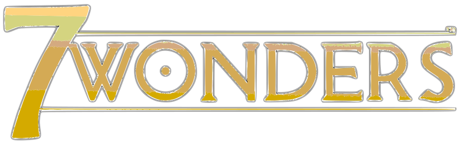
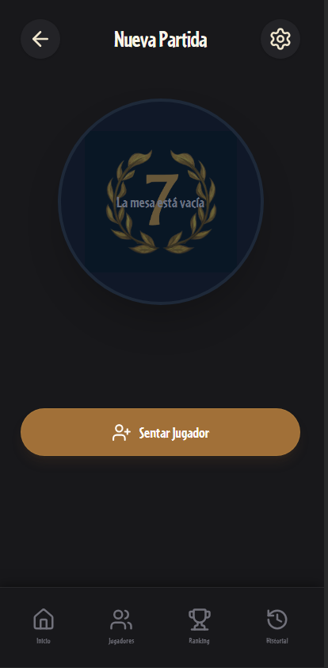
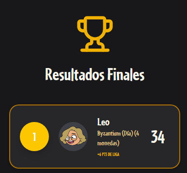

# 🏛️ 7 Wonders Companion & Score Tracker

<p align="center">
  
</p>

<p align="center">
  <strong>A premium, cinematic companion app and scoring engine for the legendary board game <em>7 Wonders</em> and its expansions.</strong>
  <br />
  <em>Engineered as a high-performance Progressive Web App (PWA) and native Android application powered by React 19, Capacitor, and Tailwind CSS.</em>
</p>

<p align="center">
  <a href="#-key-features"></a>
  <a href="#-tech-stack"></a>
  <a href="#-android-build-guide"></a>
  <a href="#-tech-stack"></a>
  <a href="#-offline-first-architecture"></a>
  <a href="#-offline-first-architecture"></a>
</p>

---

## 📸 Screenshots Showcase

<p align="center">
  
  &nbsp;
  
</p>

---

## ✨ Key Features

### 👥 Player Management & Camera Integration
- **Real-Time Camera Avatars**: Capture player profile photos directly using device hardware via `@capacitor/camera` or upload from your gallery.
- **Player Profiles & Deep Analytics**: Detailed career profiles tracking total matches played, win rate, total points, and tournament trophies.
- **Smart Heuristics**: Automatic calculation of each player's **Favorite Wonder** and **Strongest Scoring Category** (Military, Science, Civilian, Guilds, etc.) based on historical match performance.

### 🎲 Match Modes: Quick Games & Tournaments
- **Quick Match**: Intuitive table setup for 2 to 7+ players with wonder assignments, supporting Day (A), Night (B), and Option (O) sides.
- **Tournament / League Engine**: Manage multi-round championship events with persistent league points, custom win bonuses, and real-time accumulated leaderboards.

### 🧮 Comprehensive Score Calculator
- **Base Game & Full Expansions**: Complete support for base categories (*Military, Treasury, Wonder Stages, Civilian, Commercial, Guilds, Science*) plus expansions:
  - 👑 **Leaders**
  - 🏙️ **Cities** (including Debt tokens)
  - ⚓ **Armada** (Naval conflicts & Island discovery)
  - 🏛️ **Edifice** projects
- **Automated Science Matrix**: Calculates complex science sets, identical symbols ($n^2$), and wildcard combinations in real time.

### 🏆 3D Animated Podium & Tie-Breakers
- **Celebration & Micro-interactions**: 3D step podium for 1st, 2nd, and 3rd place with fluid Framer Motion transitions and confetti effects.
- **Official Tie-Breaking**: Automatic tie resolution based on official 7 Wonders rules (wealth/coin count).

### 📜 Match & Tournament History
- **Immutable Historical Logs**: Comprehensive history view displaying both casual games and league events.
- **Inspect Past Tables**: Open any previous match or tournament to inspect category-by-category breakdowns for every player.

### 💾 100% Offline-First Architecture
- **Zero Backend Required**: All state is managed locally via **Zustand** and persisted asynchronously using **IndexedDB** (`idb-keyval`).
- Fast, secure, and completely functional without an internet connection.

### 🎨 Ancient Greco-Roman Aesthetic
- Styled with bespoke Greek ornamental borders (*greca*), dual theme support (**Parchment Day Mode** and **Dark Obsidian Night Mode**), and background video atmosphere.

---

## 🏗️ Project Architecture

```
7Wonders/
├── android/                   # Native Android Studio project (Capacitor bridge)
├── assets/                    # App launcher icons & splash generation assets
├── screenshots/               # Application preview screenshots
├── public/                    # Static public assets (manifest, favicons)
├── src/
│   ├── assets/                # Fonts, wonder board art, Greek SVGs, ambient video
│   ├── components/            # Reusable UI components & layouts
│   │   ├── ui/                # Base primitives (Button, inputs, cards)
│   │   ├── BottomNavigationBar.jsx
│   │   └── Layout.jsx
│   ├── pages/                 # Application views & route screens
│   │   ├── Home.jsx           # Welcome screen & mode selection
│   │   ├── PlayersList.jsx    # Player roster & camera avatar creation
│   │   ├── PlayerProfile.jsx  # Player statistics & favorite wonders
│   │   ├── SetupGame.jsx      # Match creation & wonder picker
│   │   ├── SetupTournament.jsx# Tournament setup & league config
│   │   ├── ScoreEntry.jsx     # Category scoring matrix
│   │   ├── Results.jsx        # 3D podium & rankings
│   │   ├── MatchHistory.jsx   # Match logs & tournament records
│   │   ├── MatchDetails.jsx   # Match breakdown view
│   │   ├── TournamentHistory.jsx # Tournament standings & tables
│   │   └── Leaderboard.jsx    # Global player leaderboard
│   ├── store/                 # Zustand state stores (offline persistence)
│   │   ├── game.store.js
│   │   ├── history.store.js
│   │   ├── players.store.js
│   │   ├── theme.store.js
│   │   └── tournament.store.js
│   ├── utils/                 # Scoring logic, science math & IDB storage
│   ├── App.jsx                # Route definitions & animations
│   ├── main.jsx               # React entry point
│   └── index.css              # Tailwind CSS styles & typography
├── capacitor.config.json      # Capacitor native mobile configuration
├── package.json               # Dependencies & build scripts
└── vite.config.js             # Vite 8 & PWA bundler configuration
```

---

## 🛠️ Tech Stack

| Layer | Technology | Description |
| :--- | :--- | :--- |
| **Framework** | [React 19](https://react.dev/) | Modern component architecture with hooks |
| **Build Tool** | [Vite 8](https://vitejs.dev/) | Next-generation frontend tooling |
| **Mobile Bridge** | [Capacitor 8](https://capacitorjs.com/) | Native Android runtime & hardware camera access |
| **Styling** | [Tailwind CSS 4](https://tailwindcss.com/) | Modern utility-first responsive styling |
| **Animations** | [Framer Motion](https://www.framer.com/motion/) | Smooth page transitions and dynamic podium animations |
| **State Management** | [Zustand](https://zustand-demo.pmnd.rs/) | Lightweight predictable state containers |
| **Local Persistence**| [idb-keyval](https://github.com/jakearchibald/idb-keyval) | IndexedDB-backed offline storage |
| **Routing** | [React Router v7](https://reactrouter.com/) | Client-side routing with animated transitions |
| **Icons** | [Lucide React](https://lucide.dev/) | Crisp, modern UI icons |
| **Linter** | [Oxlint](https://oxc.rs/) | High-performance Rust-based JavaScript linter |

---

## 🚀 Getting Started (Web Development)

### Prerequisites
- [Node.js](https://nodejs.org/) (version 18.x or higher)
- [npm](https://www.npmjs.com/) (version 9.x or higher)

### Installation & Run

1. **Clone the repository:**
   ```bash
   git clone https://github.com/HarrodPablo/7wonders-score-apk.git
   cd 7wonders-score-apk
   ```

2. **Install dependencies:**
   ```bash
   npm install
   ```

3. **Start the local development server:**
   ```bash
   npm run dev
   ```
   > The application will be running at `http://localhost:5173`.

4. **Lint and verify code:**
   ```bash
   npm run lint
   ```

5. **Build for production:**
   ```bash
   npm run build
   ```

---

## 📱 Compiling for Android (Native APK)

This project is pre-configured with **Capacitor 8** and includes the native `android/` project folder ready for compilation.

### Prerequisites for Android
- [Android Studio](https://developer.android.com/studio) (Koala, Quail or later)
- Android SDK (API 34+) and JDK 17 or 21

### Build Steps

1. **Build the production web bundle and sync with Android:**
   ```bash
   npm run build
   npx cap sync android
   ```

2. **Launch Android Studio:**
   ```bash
   npx cap open android
   ```
   *(Alternatively, open Android Studio manually and select the `android` folder).*

3. **Gradle Sync:**
   - Wait for Gradle to finish downloading dependencies and indexing the project.

4. **Generate Debug APK:**
   - Navigate to the top menu: **`Build`** > **`Build Bundle(s) / APK(s)`** > **`Build APK(s)`**.
   - Once compilation finishes, click **`Locate`** in the bottom-right notification pop-up.
   - You will find your ready-to-install `app-debug.apk` in `android/app/build/outputs/apk/debug/`.

---

## 📄 License

This project is open-source and available under the [MIT License](LICENSE).

---

<p align="center">
  Crafted with care for board game enthusiasts. May the gods of antiquity favor your wonders! 🏛️⚡
</p>